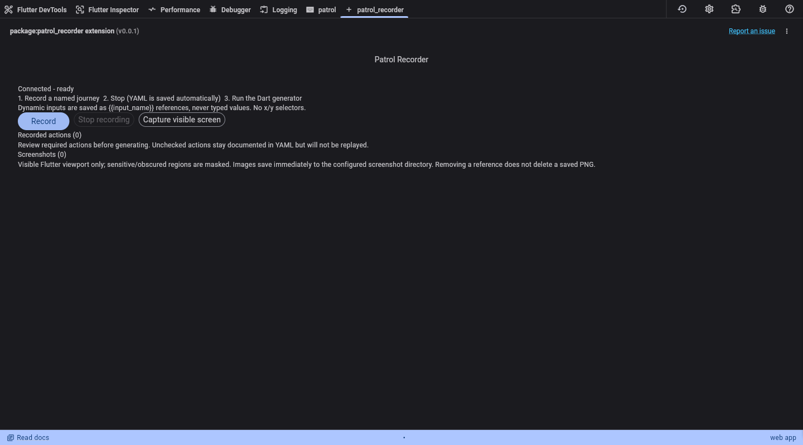
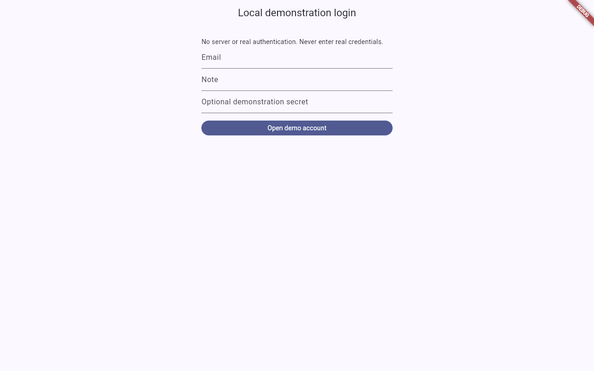
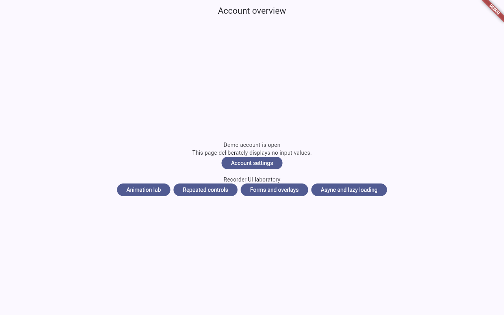
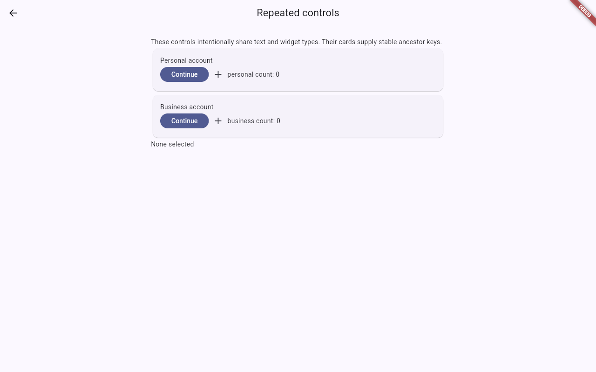

# Screenshots and demonstration

## Gallery

These screenshots show the actual local Flutter example, using only fictional
data. They demonstrate the app under test, not a claim of native-platform support.

| Screen | What to notice |
| --- | --- |
|  | The actual extension connected to the debug app, ready to record |
|  | A normal keyed Flutter form; no per-action recorder callbacks |
|  | A visible outcome to assert after replay |
|  | Identical labels in different ancestor scopes |

## Recorded video

[Watch/download the example walkthrough (WebM, 17.6 seconds)](https://github.com/anandsubbu007/patrol-code-generator/blob/main/doc/media/example-walkthrough.webm).
The repository copy is `doc/media/example-walkthrough.webm`.

This silent recording shows the actual debug example: entering fictional input,
opening the account, and navigating to repeated controls. It is an **app UI
walkthrough**, not a recording of DevTools, generation, or Patrol execution.
Use the script below to film a full narrated end-to-end release demonstration.
The video is excluded from the pub archive; the gallery PNGs are included.

## Short walkthrough script

Use a clean app state and the recording-only entrypoint:

```sh
cd example
flutter run --target patrol_test/recorder_main.dart -d chrome --print-dtd
```

1. Open the printed DevTools URL. Enable **patrol_recorder** and wait for
   **Connected - ready**.
2. Click **Record**, select the example project, and name the journey
   `publication_demo`. Save to a new journey; do not overwrite a maintained
   recording merely to film the demo.
3. Show that its YAML exists immediately with `state: recording`.
4. In the app enter `demo@example.invalid` and a fictional note. Click
   **Open demo account**.
5. In DevTools, **Capture visible screen**, name it `account_overview`, and
   save. Capture is optional, not needed for code generation.
6. Stop recording, review targets, and show **Journey YAML saved**. Open the
   YAML and point out `{{email}}` / `{{note}}`, not the typed values.
7. Run the copied command:

   ```sh
   dart run patrol_recorder_generator:generate --journey publication_demo
   ```

8. Show the four generated files. Wire the abstract getters in
   `publication_demo_inputs.dart` to fictional fixtures, then add a bounded
   account-open assertion in the user-owned test.
9. Run through Patrol:

   ```sh
   dart pub global run patrol_cli:main test \
     --target patrol_test/recorded_journeys/publication_demo/publication_demo_test.dart \
     --device chrome --web-headless
   ```

10. Show the result from that actual run. Do not present an app walkthrough as
    proof that recording, generation, or replay passed.

For a concise narrated release video, allow roughly 90-120 seconds. Film the app,
DevTools panel, YAML, input implementation, and actual CLI result in that order.
Video is optional on pub.dev; use a repository/release link rather than embedding
an HTML video player in the pub.dev README.

## Capture and privacy

- Use a separate local browser context, not a personal browser profile.
- Record only the example with fictional values. Do not show private source,
  real credentials, personal tabs, terminal history, or notifications.
- Keep VM Service and DTD URLs out of published images/video; their authentication
  tokens are local session credentials.
- Browser screenshots of the app do not apply recorder masking. Avoid entering
  sensitive data; recorder PNGs mask `obscureText`, `RecorderSensitive`, and
  `RecorderIgnore`, but other visible content can still be captured.
- Keep the gallery PNGs at `doc/images/` for pubspec screenshot paths.
  Keep video under `doc/media/`, which is excluded from the pub archive.
- Review every final image and the video before uploading. Do not claim a full
  end-to-end demo unless all stages are actually shown.
